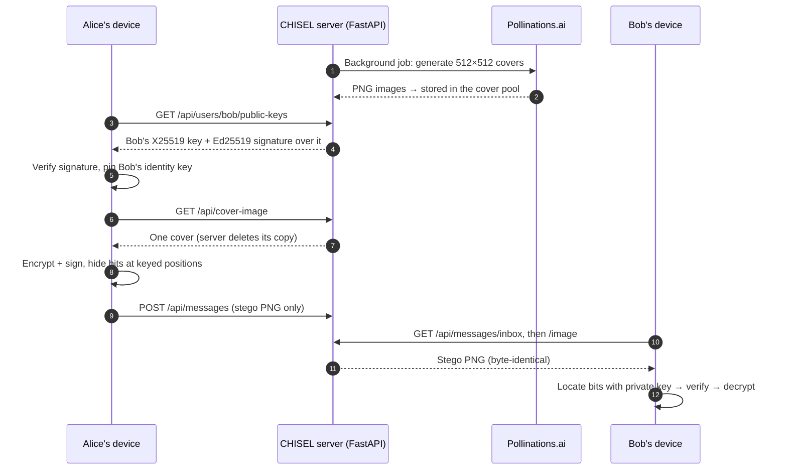

# CHISEL

**Cryptographic Hybrid Image-Steganographic Ephemeral Layer** — the secure-transport layer for a messenger that hides end-to-end encrypted text inside AI-generated images.

CC383 Cryptography & Data Privacy Lab project.

| Cover image from the pool | Same image carrying an encrypted message |
|---|---|
|  |  |

The right-hand image carries a 366-byte signed, encrypted message. The difference is invisible: **PSNR 75.8 dB** (anything above 50 dB is indistinguishable to the eye), and only 0.38 % of the image's hidden capacity is used.

---

## Contents

- [What it does](#what-it-does)
- [How a message travels](#how-a-message-travels)
- [Cryptography](#cryptography)
- [Steganography (v2: keyed scatter)](#steganography-v2-keyed-scatter)
- [Server security](#server-security)
- [API](#api)
- [Project layout](#project-layout)
- [Running locally](#running-locally)
- [Deploying for free](#deploying-for-free-render--neon--brevo)
- [Tests and results](#tests-and-results)
- [Known limitations](#known-limitations)

---

## What it does

1. A user signs up with their email and a one-time code (emailed through Brevo).
2. Their phone generates keys locally; only **public** keys are uploaded. Private keys never leave the device.
3. To send a message, the phone fetches the receiver's public key, encrypts and signs the text, and hides the result inside a 512×512 PNG taken from a pool of AI-generated images (Pollinations.ai, model `flux`).
4. The server stores and relays the PNG. It can't read the message, can't find where it is hidden, and deletes it after 24 hours.
5. The receiver's phone finds the hidden bits with its private key, verifies the sender's signature and decrypts.
6. Each user's encryption key is replaced daily and the old private key destroyed, so old messages become permanently unreadable (**cryptographic erasure**).

The name maps to the design: **C**ryptographic (AES-256-GCM, X25519, Ed25519) · **H**ybrid (public-key agreement feeding symmetric encryption, plus crypto combined with steganography) · **I**mage-**S**teganographic (bits hidden in pixel values, not metadata) · **E**phemeral (daily key rotation + 24 h expiry) · **L**ayer (a transport layer; the chat UI sits on top).

---

## How a message travels



---

## Cryptography

All of this runs on the device ([`chisel_core.py`](chisel_core.py)); the server never holds a private key.

| Piece | Algorithm | Purpose |
|---|---|---|
| Identity key | **Ed25519** (long-term) | Signs every message and the user's daily encryption key |
| Encryption key | **X25519** (rotated daily) | Receives messages; destroying it erases old messages |
| Per-message key | **X25519 ephemeral** | Fresh key pair for every message (forward secrecy per message) |
| Key derivation | **HKDF-SHA256** | Turns the ECDH shared secret into a 256-bit AES key |
| Encryption | **AES-256-GCM** | Authenticated encryption with a fresh 12-byte nonce every time |
| Authenticated metadata (AAD) | sender, receiver, message ID, expiry | Binds the ciphertext to who it's from, who it's for and when it dies; can't be rerouted or extended |

**Bundle layout** (signed as a whole by the sender's Ed25519 key):

```
[32 B ephemeral X25519 pub | 12 B nonce | 2 B AAD length | AAD JSON | 4 B ciphertext length | ciphertext + 16 B GCM tag | 64 B Ed25519 signature]
```

**Key directory hardening**

- The daily X25519 key must be **signed by the user's Ed25519 identity key**; the server checks the signature on upload and clients check it again on download.
- The identity key is **pinned**: once uploaded it can't be replaced (HTTP 409).
- Clients keep a **trust-on-first-use pin store** (`KeyPinStore`) and refuse a contact whose identity key changes.
- Every identity key has a **30-digit fingerprint** (six groups of five) that two people can compare in person.
- **Replay protection**: a device remembers message IDs it has opened and rejects repeats.

---

## Steganography (v2: keyed scatter)

The first version wrote bits in order from the first pixel. That put every change in the top two rows and let anyone read the bundle back out — including the plain-text AAD with the sender's and receiver's emails. Version 2 (`seal_into_image` / `open_from_image`) fixes both:

1. **Header (32 bytes)** — the message's one-time public key, written at positions derived from the **receiver's public key** (via HKDF → ChaCha20 keystream). Its always-zero top bit is randomised, so the header is uniformly random.
2. **Body** — length + rest of the bundle, at positions derived from the **ECDH shared secret**. Only the real receiver can compute them, and they change with every message.
3. **LSB matching** — when a bit must change, the channel value moves by a random **+1 or −1** instead of having its last bit overwritten, removing the pairs-of-values signature that chi-square / RS steganalysis detects.


*Same message, same cover. Middle: old sequential method, every change in rows 0–1. Right: keyed scatter, changes spread over 467 of 512 rows (dots thickened so they're visible).*


| | Old (sequential LSB) | New (keyed scatter) |
|---|---|---|
| Rows touched (of 512) | 2 | 467 |
| Who can find the bits | anyone | only the receiver |
| Sender/receiver emails readable from the pixels | yes | no |
| Change per value | last bit overwritten | ±1 at random |
| Same positions for every message | yes | no (0.5 % overlap between two messages) |
| Wrong person opening it | fails at signature/decryption | can't even locate the payload |

The cover must stay **lossless**: the server only accepts genuine 512×512 PNGs and never re-encodes them (JPEG would destroy the hidden bits).

---

## Server security

[`server/`](server) is a FastAPI app (async SQLAlchemy; SQLite locally, Postgres/Neon in production).

| Area | Protection |
|---|---|
| Sign-in codes | 6 digits from the OS CSPRNG (`secrets`); only an **HMAC-SHA256 hash** is stored; burned after **5 wrong guesses**; one code per email per **30 s**; a new code cancels older ones; expire after **5 min** |
| Code delivery | Brevo HTTPS API (works on free hosts that block SMTP); in production codes are **never** returned in API responses |
| Rate limiting | Per-IP sliding window on sign-up and verify endpoints |
| Tokens | PyJWT, algorithm pinned (HS256), `exp`/`sub`/`iat` required, `alg=none` rejected |
| Key directory | Lookups need sign-in; "no such user" and "no keys yet" give the same answer |
| Uploads | Must be a valid, uncorrupted 512×512 PNG, max 2 MiB |
| Cover pool | Covers are **deleted** the moment they're handed out (the server can't diff cover vs stego later), atomically, so no two senders get the same one |
| Messages | Only the receiver can download; sender or receiver can delete; expired messages purged hourly |
| Admin | `/api/admin/*` restricted to `ADMIN_EMAILS` |
| Production guard | Refuses to start with the default secret, demo codes on, missing Brevo settings or `CORS_ORIGINS=*`; API docs hidden |
| Headers | `nosniff`, `X-Frame-Options: DENY`, `Referrer-Policy: no-referrer`, `Cache-Control: no-store` |

---

## API

| Method | Path | Auth | Purpose |
|---|---|---|---|
| POST | `/api/register` | – | Email a one-time code |
| POST | `/api/verify-otp` | – | Verify code → create account → JWT |
| PUT | `/api/keys` | user | Upload signed public keys (identity key pinned) |
| GET | `/api/users/{email}/public-keys` | user | Signed keys + fingerprint |
| GET | `/api/cover-image` | user | Take one cover from the pool |
| POST | `/api/messages` | user | Send a stego PNG to a receiver |
| GET | `/api/messages/inbox` | user | List incoming, unexpired messages |
| GET | `/api/messages/{id}/image` | receiver | Download a stego PNG |
| DELETE | `/api/messages/{id}` | sender or receiver | Delete a message |
| GET | `/api/pool-status` | user | Cover pool size |
| POST | `/api/admin/seed-pool?count=n` | admin | Generate `n` covers now (max 20) |
| GET | `/api/health` | – | Health check |

---

## Project layout

```
chisel-msg/
├── chisel_core.py        # Device-side crypto + steganography (+ runnable demo)
├── image_pool.py         # Standalone Pollinations cover generator (phase-2 demo)
├── server/
│   ├── main.py           # FastAPI routes
│   ├── auth.py           # OTP hashing, JWT, rate limiting, admin check
│   ├── emailer.py        # Brevo HTTPS email delivery
│   ├── keyutil.py        # Signed-key verification + fingerprints
│   ├── pool.py           # Cover pool (fetch, store, atomic pop)
│   ├── tasks.py          # Background pool refill + expiry cleanup
│   ├── models.py         # users, otps, messages, cover_images
│   ├── schemas.py        # Request/response models
│   ├── config.py         # Settings + production safety checks
│   └── database.py       # Async engine (Neon-ready)
├── test_e2e.py           # Full pipeline through the API
├── test_audit.py         # 72 timed checks (API, security, crypto, stego)
├── test_email.py         # Email delivery against a fake Brevo
├── render.yaml           # Render Blueprint (free web service)
├── .env.example          # All settings, with comments
└── docs/images/          # Images used in this README
```

---

## Running locally

Requires Python 3.12+.

```bash
python3 -m venv .venv
.venv/bin/pip install -r server/requirements.txt
cp .env.example .env        # add your Pollinations key; leave BREVO_API_KEY empty
.venv/bin/python -m uvicorn server.main:app --port 8000
```

- With no Brevo key, sign-in codes are printed in the server log and (with `DEMO_RETURN_OTP=true`) returned by `/api/register`.
- Swagger UI: <http://127.0.0.1:8000/docs> (hidden in production).
- Device-side demo, no server needed: `.venv/bin/python chisel_core.py`

---

## Deploying for free (Render + Neon + Brevo)

| Part | Service | Free tier |
|---|---|---|
| API server | **Render** web service | Sleeps after 15 min idle; first request then takes up to ~1 min |
| Database | **Neon** Postgres | 1 GB, doesn't expire |
| Email | **Brevo** HTTPS API | 300 emails/day |
| Cover images | **Pollinations.ai** | Generated on the server, pooled |

1. Push this repo to GitHub.
2. Render → **New → Blueprint** → pick the repo. [`render.yaml`](render.yaml) sets production mode and generates `SECRET_KEY`.
3. Fill in the prompted values: `DATABASE_URL` (Neon connection string, pasted as-is), `BREVO_API_KEY`, `EMAIL_SENDER_ADDRESS` (a sender verified in Brevo), `ADMIN_EMAILS`, `POLLINATIONS_API_KEY`.
4. Check `https://<service>.onrender.com/api/health` → `{"status":"ok","service":"CHISEL"}`.

Never commit `.env` or `.env.production`; both are git-ignored.

---

## Tests and results

```bash
.venv/bin/python test_email.py                  # no server needed
ADMIN_EMAILS=admin@gbu.ac.in .venv/bin/python -m uvicorn server.main:app --port 8000 &
.venv/bin/python test_e2e.py
.venv/bin/python test_audit.py                  # use a fresh chisel.db
```

| Suite | Result |
|---|---|
| `test_audit.py` (local, SQLite) | **72 / 72** in 7.7 s — health, auth, keys, pool, message pipeline, security boundaries, crypto integrity, steganography, lifecycle, auth hardening |
| `test_e2e.py` | Passes |
| `test_email.py` | **19 / 19** — code arrives only by email, Brevo failures return 502, production guard |
| Live two-way test (Render + Neon + Brevo) | **33 / 33** in 31.3 s — fresh sign-up by emailed code, key upload and verification, one message each way, replay/tamper/wrong-receiver checks, cleanup |

Selected checks from the audit:

- Reused or brute-forced code → rejected; 5 wrong guesses burn the code
- Forged `alg=none` JWT → 401
- X25519 key signed by the wrong identity → 400; identity key swap → 409
- Server-side key swap detected by the client (signature check and TOFU pin)
- JPEG, wrong-size, corrupted or > 2 MiB uploads → rejected
- One flipped payload bit → rejected; wrong receiver → can't locate the payload
- Old ciphertext unreadable after daily key rotation (cryptographic erasure)
- Outsider reading LSBs in order: old format leaks the sender JSON, new format doesn't

Typical timings: encrypt + sign **~2 ms**, hide in image **~80 ms**, locate + verify + decrypt **~2–40 ms** on the device; each API call **~1–2.5 s** on the free hosting tiers (most of it network distance).

---

## Known limitations

- **Metadata:** the server still knows who messages whom and when (it needs that to deliver).
- **Trust on first use:** the first identity key seen for a contact is trusted; compare fingerprints in person for real assurance.
- **Lost device = lost account keys:** the identity key is pinned and there is no key-reset flow yet.
- **Sender address:** without an owned domain, Brevo rewrites the From address to `…@brevosend.com`; some inboxes may file codes as spam.
- **Rate limits** are in-memory (fine for one instance; use Redis for several).
- **Free hosting** sleeps when idle; open `/api/health` a minute before a demo.
- **Frontend:** the Flutter app is not built yet; tests drive the device-side code directly.
