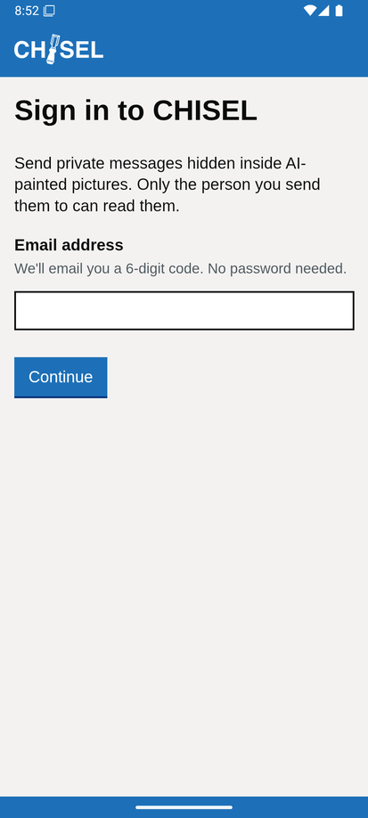
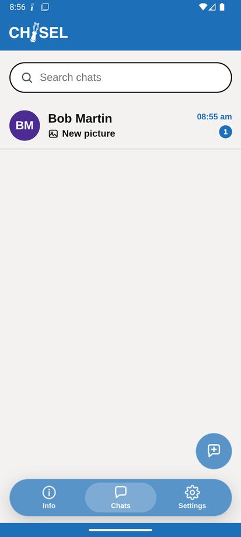
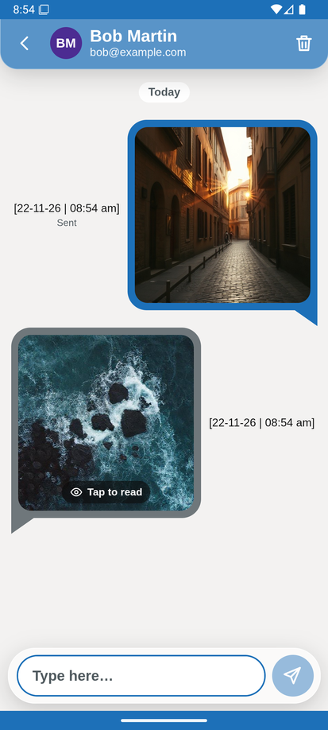
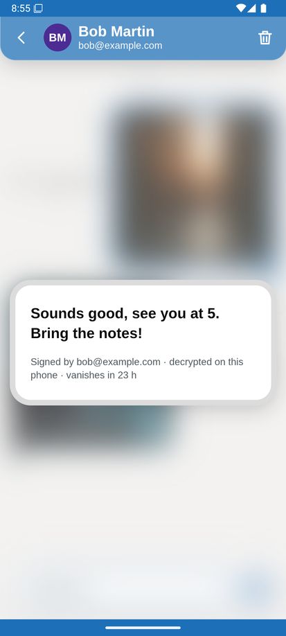
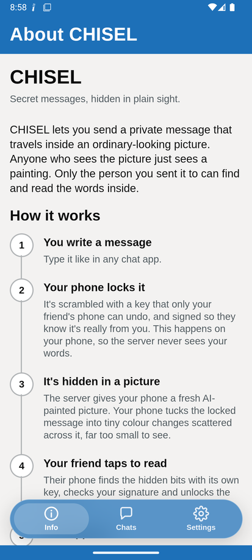
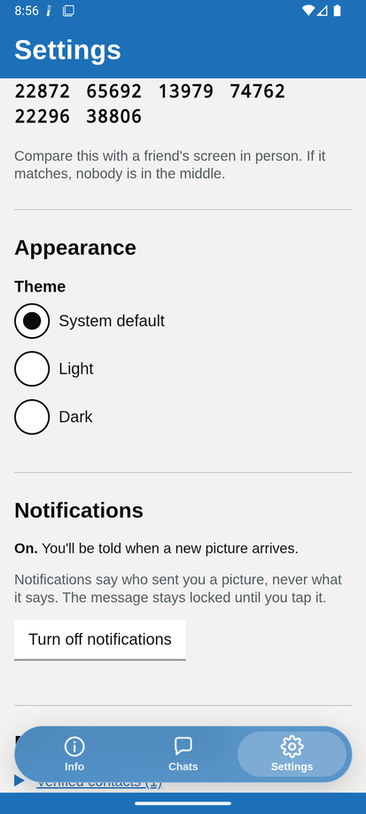
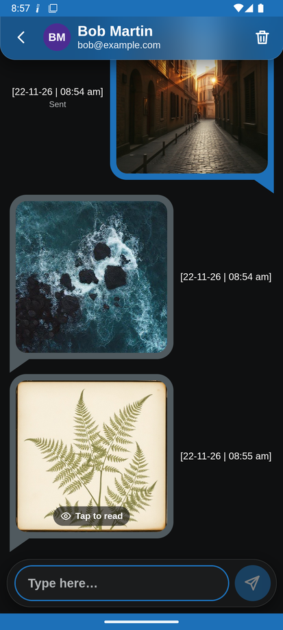
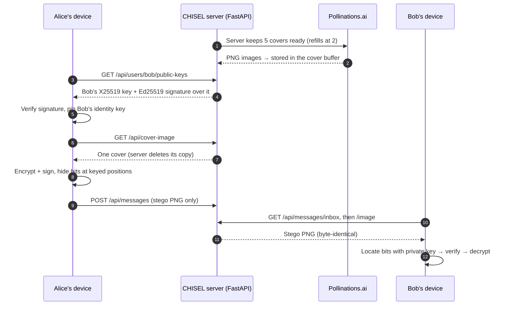
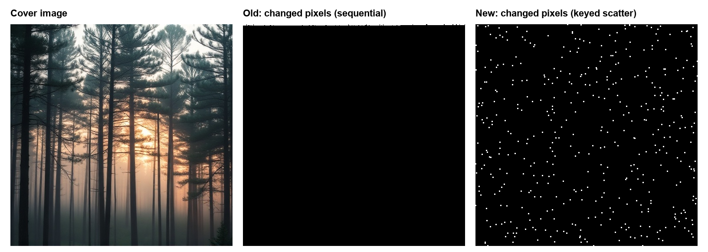
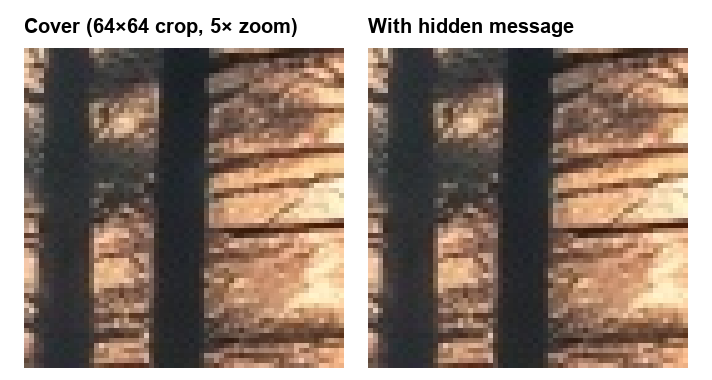

# CHISEL


**Cryptographic Hybrid Image-Steganographic Ephemeral Layer**: a messenger for Android and the web that hides end-to-end encrypted text inside AI-generated pictures.

Made by **Divyansh Kumar Verma** ([@DivyanshKVerma](https://github.com/DivyanshKVerma)) and **Saatwika Saini** ([@SaatwikaSaini](https://github.com/SaatwikaSaini)).

**Version 1.1.0** · Android 7.0+ · Server on Render · [Walkthrough with screenshots](docs/WALKTHROUGH.md) · [Changelog](CHANGELOG.md)

| Cover image from the pool | Same image carrying an encrypted message |
|---|---|
|  |  |

The right-hand image carries a 366-byte signed, encrypted message. The difference is invisible: **PSNR 75.8 dB** (anything above 50 dB is indistinguishable to the eye), and only 0.38 % of the image's hidden capacity is used.

---

## Contents

- [Get the app](#get-the-app)
- [What it does](#what-it-does)
- [The app](#the-app)
- [Android APK](#android-apk)
- [How a message travels](#how-a-message-travels)
- [Cryptography](#cryptography)
- [Steganography (v2: keyed scatter)](#steganography-v2-keyed-scatter)
- [Cover image buffer](#cover-image-buffer)
- [Server security](#server-security)
- [API](#api)
- [Project layout](#project-layout)
- [Running locally](#running-locally)
- [Deploying for free](#deploying-for-free-render--neon--brevo)
- [Tests and results](#tests-and-results)
- [Known limitations](#known-limitations)

---

## Get the app

| | |
|---|---|
| **Android** | Install `CHISEL-1.1.0.apk` (a signed release build; see [Android APK](#android-apk) to build it). Allow *Install unknown apps* for your file manager or browser when Android asks. |
| **Any phone browser** | Open the server URL (`https://chisel-api-1mkl.onrender.com/`) and choose *Add to Home Screen*. |
| **Needs** | An internet connection and an email address you can read. Nothing else to install: no Google account, Play Store or other apps. |

New to Chisel? The [walkthrough](docs/WALKTHROUGH.md) goes from installing to reading your first hidden message, screen by screen.

---

## What it does

1. A user opens Chisel (the Android app, or the same app in a phone browser) and signs up with their email and a one-time code (emailed through Brevo).
2. Their phone generates keys locally; only **public** keys are uploaded. Private keys never leave the device.
3. To send a message, the phone fetches the receiver's public key, encrypts and signs the text, and hides the result inside a 512×512 PNG taken from the server's buffer of AI-generated images (generated **on the server** with Pollinations.ai, model `flux`).
4. The server stores and relays the PNG. It can't read the message, can't find where it is hidden, and deletes it after 24 hours.
5. The receiver's phone finds the hidden bits with its private key, verifies the sender's signature and decrypts.
6. Each user's encryption key is replaced daily and the old private key destroyed, so old messages become permanently unreadable (**cryptographic erasure**).

The name maps to the design: **C**ryptographic (AES-256-GCM, X25519, Ed25519) · **H**ybrid (public-key agreement feeding symmetric encryption, plus crypto combined with steganography) · **I**mage-**S**teganographic (bits hidden in pixel values, not metadata) · **E**phemeral (daily key rotation + 24 h expiry) · **L**ayer (a transport layer; the chat UI sits on top).

---

## The app

One app, two ways to get it: the **Android APK** (Capacitor) or the **web app** served by the same server at `/` (open it in any phone browser and *Add to Home Screen*). Both run the same code from [`web/`](web), and all encryption and image work happens on the phone; the server only relays pictures and generates covers.

| Sign in | Chats | Chat | Tap to reveal |
|---|---|---|---|
|  |  |  |  |

| Info | Settings | Dark mode |
|---|---|---|
|  |  |  |

**Design.** The interface uses a clear, accessible type scale, a blue accent colour (#1d70b8), the CHISEL wordmark as the title, form fields with 2 px borders, a rounded search bar, error messaging, notification banners, summary lists, radio controls, expandable details, and step-by-step flows. Text fields show no focus highlight while typing. Glassmorphism (backdrop blur and translucency) is used for the floating bottom tab bar, the round new-chat button, the chat header and the message composer; the new-chat and send buttons have no drop shadow. Speech-bubble tails sit at the outer corners: bottom-left for pictures you receive, bottom-right for yours. The typeface is Arimo (Arial-metric, SIL Open Font License), bundled with the app.

| Screen | What it does |
|---|---|
| **Sign in** | Email → 6-digit code → keys generated on the phone (only signed public keys are uploaded) → new users choose a display name |
| **Chats** | Conversations sorted by latest picture, unread counts, search; **pull down to refresh**; the round glass **new-chat button** sits bottom-right like WhatsApp |
| **Chat** | Glass header with the contact's name and email (**tap it to see their safety number** and yours, to compare in person); picture bubbles (received left in grey, sent right in blue) with `[DD-MM-YY \| hh:mm am/pm]` stamps; glass composer to type and send |
| **Tap a picture** | Everything but the header is blurred to **15 pt** at **70 % opacity**, and the decrypted text appears in a card. Your own sent text comes from this phone's copy |
| **Info** | Plain-language explanation, glossary, the technology, and the developers' GitHub links |
| **Settings** | Name, email, safety number; **notifications** on/off; **System / Light / Dark** theme; verified contacts; renew daily key; delete all chats; sign out; remove keys; delete account (confirmed with an email code) |

How it works on the phone:

- [`web/js/chisel.js`](web/js/chisel.js) is a **byte-compatible JavaScript port** of `chisel_core.py`; [`test_interop.py`](test_interop.py) proves Python ↔ JS messages open both ways with identical pixel positions and safety numbers.
- Crypto comes from the audited [@noble](https://paulmillr.com/noble/) libraries and PNG compression from [fflate](https://github.com/101arrowz/fflate), bundled into [`web/vendor/libs.js`](web/vendor/libs.js); nothing loads from a CDN, so the APK runs from its own files.
- [`web/js/png.js`](web/js/png.js) reads and writes PNG pixels exactly (never `<canvas>`, which can alter pixels and destroy hidden bits).
- Sent pictures and their text are kept **on the sender's phone only** (IndexedDB) so both sides of a chat show; they're deleted after 24 h like the server copy.
- Keys renew daily (cryptographic erasure); a changed safety number blocks sending or reading until the user compares the numbers and trusts the new one.
- Strict Content-Security-Policy, and all user text is inserted as text, never HTML.
- **Notifications** ([`web/js/notify.js`](web/js/notify.js), [`mobile/runners/inbox.js`](mobile/runners/inbox.js)): they name the sender only; the message stays locked in the picture. On Android, `@capacitor/local-notifications` covers the open app and `@capacitor/background-runner` checks the inbox about every 15 minutes while CHISEL is closed (it reads only inbox metadata, has no keys, and stores the session token in app-private storage that is excluded from backups). Browsers use the Notification API while the tab is open in the background. One notification per chat, updated rather than stacked.

---

## Android APK

The Android app is in [`mobile/`](mobile): Capacitor 8 wrapping [`web/`](web), package **`com.chisel.messenger`**, version **1.1.0** (version code 2; installs over 1.0.0 and keeps keys and chats).

| | |
|---|---|
| Android versions | 7.0 (API 24) to 16 (API 36) |
| System WebView | Chrome 67 or newer (updated automatically on almost all phones). If it's older, Chisel shows how to update it instead of failing |
| Permissions | Internet and notifications (Android 13+ asks once). Location and exact-alarm permissions that plugins would add are removed in the manifest |
| Server | `https://chisel-api-1mkl.onrender.com` over HTTPS; cleartext HTTP is blocked |
| Signing | Release build, signed with the Chisel release key (APK Signature Scheme v2). Certificate SHA-256: `03:47:E0:09:E1:27:D1:83:26:3E:68:94:07:CE:7A:75:82:F5:63:23:49:87:7C:20:56:DB:20:2A:41:AA:FB:F3` |
| Hardening | Not debuggable; Android backup disabled (`allowBackup=false`) so private keys never leave the phone in a cloud backup |
| Tested on | Android 16 emulator (Pixel-class, WebView 133): upgrade from 1.0.0, sign-up, notification permission, chat with a second client, reveal, contact safety number, pull to refresh, background notification and tapping it, back button, themes, launcher icon |

What makes it work on any Android phone:

- Everything the app needs is inside the APK: code, crypto, fonts and icons. The phone only needs internet access to reach the server.
- The build compiles the app to older JavaScript ([esbuild](https://esbuild.github.io/), Chrome 67 target) and the PNG codec uses bundled zlib instead of newer browser APIs.
- [`web/js/compat.js`](web/js/compat.js) runs first and, on a WebView too old for the cryptography, explains how to update it.
- The system-bar areas are Chisel blue on every WebView version (edge-to-edge on new ones, a blue window background on old ones).

### Building the APK

Needs Node.js, JDK 21 and the Android SDK:

```bash
brew install node openjdk@21
brew install --cask android-commandlinetools
export JAVA_HOME="$(brew --prefix openjdk@21)/libexec/openjdk.jdk/Contents/Home"
export ANDROID_HOME="$(brew --prefix)/share/android-commandlinetools"
sdkmanager --sdk_root="$ANDROID_HOME" "platform-tools" "platforms;android-36" "build-tools;35.0.0"

cd mobile && npm install
export CHISEL_KEYSTORE_PROPERTIES=/path/to/keystore.properties   # release key, kept out of git
npm run apk          # → android/app/build/outputs/apk/release/app-release.apk
npm run apk:debug    # unsigned-by-you debug build, for development only
```

`keystore.properties` holds `storeFile`, `storePassword`, `keyAlias` and `keyPassword`. **Keep the keystore and its passwords safe and private:** every future update must be signed with the same key, or phones will refuse to install it over the old version.

- `npm run www` copies `web/` into the app, bundles it and points it at the server (`CHISEL_API_BASE=http://… npm run www` for a test server).
- `python make-icons.py` regenerates the web icons, launcher icons, splash screens and the notification icon from [`web/icons/chisel-icon.svg`](web/icons/chisel-icon.svg) and [`web/icons/chisel-wordmark.svg`](web/icons/chisel-wordmark.svg) (rasterised to `chisel-icon-source.png` and `chisel-wordmark.png`).
- To rebuild the bundled libraries: `cd web-src && npm install && npm run build`.

---

## How a message travels



---

## Cryptography

All of this runs on the device ([`chisel_core.py`](chisel_core.py)); the server never holds a private key.

| Piece | Algorithm | Purpose |
|---|---|---|
| Identity key | **Ed25519** (long-term) | Signs every message and the user's daily encryption key |
| Encryption key | **X25519** (rotated daily) | Receives messages; destroying it erases old messages |
| Per-message key | **X25519 ephemeral** | Fresh key pair for every message (forward secrecy per message) |
| Key derivation | **HKDF-SHA256** | Turns the ECDH shared secret into a 256-bit AES key |
| Encryption | **AES-256-GCM** | Authenticated encryption with a fresh 12-byte nonce every time |
| Authenticated metadata (AAD) | sender, receiver, message ID, expiry | Binds the ciphertext to who it's from, who it's for and when it dies; can't be rerouted or extended |

**Bundle layout** (signed as a whole by the sender's Ed25519 key):

```
[32 B ephemeral X25519 pub | 12 B nonce | 2 B AAD length | AAD JSON | 4 B ciphertext length | ciphertext + 16 B GCM tag | 64 B Ed25519 signature]
```

**Key directory hardening**

- The daily X25519 key must be **signed by the user's Ed25519 identity key**; the server checks the signature on upload and clients check it again on download.
- The identity key is **pinned**: once uploaded it can't be replaced (HTTP 409).
- Clients keep a **trust-on-first-use pin store** (`KeyPinStore`) and refuse a contact whose identity key changes.
- Every identity key has a **30-digit fingerprint** (six groups of five) that two people can compare in person.
- **Replay protection**: a device remembers message IDs it has opened and rejects repeats.

---

## Steganography (v2: keyed scatter)

The first version wrote bits in order from the first pixel. That put every change in the top two rows and let anyone read the bundle back out — including the plain-text AAD with the sender's and receiver's emails. Version 2 (`seal_into_image` / `open_from_image`) fixes both:

1. **Header (32 bytes)** — the message's one-time public key, written at positions derived from the **receiver's public key** (via HKDF → ChaCha20 keystream). Its always-zero top bit is randomised, so the header is uniformly random.
2. **Body** — length + rest of the bundle, at positions derived from the **ECDH shared secret**. Only the real receiver can compute them, and they change with every message.
3. **LSB matching** — when a bit must change, the channel value moves by a random **+1 or −1** instead of having its last bit overwritten, removing the pairs-of-values signature that chi-square / RS steganalysis detects.



*Same message, same cover. Middle: old sequential method, every change in rows 0–1. Right: keyed scatter, changes spread over 467 of 512 rows (dots thickened so they're visible).*



| | Old (sequential LSB) | New (keyed scatter) |
|---|---|---|
| Rows touched (of 512) | 2 | 467 |
| Who can find the bits | anyone | only the receiver |
| Sender/receiver emails readable from the pixels | yes | no |
| Change per value | last bit overwritten | ±1 at random |
| Same positions for every message | yes | no (0.5 % overlap between two messages) |
| Wrong person opening it | fails at signature/decryption | can't even locate the payload |

The cover must stay **lossless**: the server only accepts genuine 512×512 PNGs and never re-encodes them (JPEG would destroy the hidden bits).

---

## Cover image buffer

Images are generated **on the server only** ([`server/pool.py`](server/pool.py)):

- Each cover comes from a random prompt: one of **100 subjects** (landscapes, textures, architecture, sky, wildlife, art styles) × one of **10 styles** × a random seed, so chats rarely show similar pictures. Prompts never depend on what users write.
- The server keeps a buffer of **5** AI-generated 512×512 covers in the database.
- Every time a sender takes one, the server checks the buffer; once **2 or fewer** remain it generates enough new images (in the background) to get back to 5.
- Refills are single-flight: several triggers at once produce one refill.
- The buffer is also filled at startup and re-checked every 5 minutes as a safety net (e.g. if Pollinations was briefly down). An empty buffer returns 503 "try again" and starts a refill; the app waits and retries automatically.
- Settings: `POOL_TARGET_SIZE=5`, `POOL_REFILL_THRESHOLD=2`, `POOL_CHECK_INTERVAL_SECONDS=300`.

---

## Server security

[`server/`](server) is a FastAPI app (async SQLAlchemy; SQLite locally, Postgres/Neon in production).

| Area | Protection |
|---|---|
| Sign-in codes | 6 digits from the OS CSPRNG (`secrets`); only an **HMAC-SHA256 hash** is stored; burned after **5 wrong guesses**; one code per email per **30 s**; a new code cancels older ones; expire after **5 min** |
| Code delivery | Brevo HTTPS API (works on free hosts that block SMTP); in production codes are **never** returned in API responses |
| Rate limiting | Per-IP sliding window on sign-up and verify endpoints |
| Tokens | PyJWT, algorithm pinned (HS256), `exp`/`sub`/`iat` required, `alg=none` rejected |
| Key directory | Lookups need sign-in; "no such user" and "no keys yet" give the same answer |
| Key reset | A pinned identity key can be replaced (new phone / cleared browser) only with `reset_identity` **and** a token from an email-code sign-in in the last 10 min; old waiting messages are deleted and contacts see the safety number change |
| Phone app | Served with a strict CSP (`script-src 'self'`, `frame-ancestors 'none'`); `Cache-Control: no-cache` so updates arrive |
| Uploads | Must be a valid, uncorrupted 512×512 PNG, max 2 MiB |
| Cover pool | Covers are **deleted** the moment they're handed out (the server can't diff cover vs stego later), atomically, so no two senders get the same one |
| Messages | Only the receiver can download; sender or receiver can delete; expired messages purged hourly |
| Admin | `/api/admin/*` restricted to `ADMIN_EMAILS` |
| Production guard | Refuses to start with the default secret, demo codes on, missing Brevo settings or `CORS_ORIGINS=*`; API docs hidden |
| Headers | `nosniff`, `X-Frame-Options: DENY`, `Referrer-Policy: no-referrer`, `Cache-Control: no-store` |

---

## API

| Method | Path | Auth | Purpose |
|---|---|---|---|
| POST | `/api/register` | – | Email a one-time code |
| POST | `/api/verify-otp` | – | Verify code → create account → JWT |
| PUT | `/api/keys` | user | Upload signed public keys (identity key pinned; `reset_identity` after a fresh sign-in) |
| GET | `/api/users/{email}/public-keys` | user | Signed keys + fingerprint |
| GET | `/api/cover-image` | user | Take one cover from the pool |
| POST | `/api/messages` | user | Send a stego PNG to a receiver |
| GET | `/api/messages/inbox` | user | List incoming, unexpired messages |
| GET | `/api/messages/{id}/image` | receiver | Download a stego PNG |
| DELETE | `/api/messages/{id}` | sender or receiver | Delete a message |
| GET | `/api/pool-status` | user | Cover buffer size, target, refill threshold, refilling now |
| POST | `/api/admin/seed-pool?count=n` | admin | Generate `n` covers now (max 20) |
| GET / PUT | `/api/me` | user | Your profile; set the display name others see (1–40 characters) |
| DELETE | `/api/me` | user, fresh sign-in | Delete your account, keys and all your messages |
| DELETE | `/api/chats?with=email` | user | Clear pictures sent to you by one contact, or by everyone if `with` is omitted |
| GET | `/api/health` | – | Health check |
| GET | `/` | – | The phone app |

---

## Project layout

```
chisel-msg/
├── chisel_core.py        # Device-side crypto + steganography (+ runnable demo)
├── image_pool.py         # Standalone Pollinations cover generator (phase-2 demo)
├── mobile/               # Android app (Capacitor): config, web copy step, icon generator, android/
├── web/                  # The app (served at /, bundled into the APK): HTML, CSS, JS, fonts, icons
│   ├── js/chisel.js      # JS port of chisel_core (byte-compatible)
│   ├── js/png.js         # Exact PNG decode/encode
│   ├── js/app.js         # Screens and flows (sign in, chats, chat, reveal, info, settings)
│   ├── js/data.js        # On-phone storage: sent copies, contacts, read state, picture cache
│   ├── js/compat.js      # Runs first: explains how to update a too-old WebView
│   └── vendor/libs.js    # Bundled @noble crypto + fflate zlib
├── web-src/              # npm project that builds vendor/libs.js + JS half of interop test
├── server/
│   ├── main.py           # FastAPI routes
│   ├── auth.py           # OTP hashing, JWT, rate limiting, admin check
│   ├── emailer.py        # Brevo HTTPS email delivery
│   ├── keyutil.py        # Signed-key verification + fingerprints
│   ├── pool.py           # Cover buffer (5, refill at 2), fetch, atomic pop
│   ├── tasks.py          # Background pool refill + expiry cleanup
│   ├── models.py         # users, otps, messages, cover_images
│   ├── schemas.py        # Request/response models
│   ├── config.py         # Settings + production safety checks
│   └── database.py       # Async engine (Neon-ready)
├── test_e2e.py           # Full pipeline through the API
├── test_audit.py         # 79 timed checks (API, security, crypto, stego, app, accounts)
├── test_email.py         # Email delivery against a fake Brevo
├── test_pool.py          # Cover buffer: 5 → 2 → refill to 5, single-flight, outages
├── test_interop.py       # Python ↔ JavaScript compatibility (needs Node.js)
├── render.yaml           # Render Blueprint (free web service)
├── .env.example          # All settings, with comments
└── docs/
    ├── WALKTHROUGH.md    # Screen-by-screen guide with Android screenshots
    └── images/           # Images used in the docs
```

---

## Running locally

Requires Python 3.12+.

```bash
python3 -m venv .venv
.venv/bin/pip install -r server/requirements.txt
cp .env.example .env        # add your Pollinations key; leave BREVO_API_KEY empty
.venv/bin/python -m uvicorn server.main:app --port 8000
```

- With no Brevo key, sign-in codes are printed in the server log and (with `DEMO_RETURN_OTP=true`) returned by `/api/register`.
- Phone app: <http://127.0.0.1:8000/> (on a phone on the same Wi-Fi, start uvicorn with `--host 0.0.0.0` and open your computer's LAN address).
- Swagger UI: <http://127.0.0.1:8000/docs> (hidden in production).
- Device-side demo, no server needed: `.venv/bin/python chisel_core.py`

---

## Deploying for free (Render + Neon + Brevo)

| Part | Service | Free tier |
|---|---|---|
| API server | **Render** web service | Sleeps after 15 min idle; first request then takes up to ~1 min |
| Database | **Neon** Postgres | 1 GB, doesn't expire |
| Email | **Brevo** HTTPS API | 300 emails/day |
| Cover images | **Pollinations.ai** | Generated on the server, pooled |

1. Push this repo to GitHub.
2. Render → **New → Blueprint** → pick the repo. [`render.yaml`](render.yaml) sets production mode and generates `SECRET_KEY`.
3. Fill in the prompted values: `DATABASE_URL` (Neon connection string, pasted as-is), `BREVO_API_KEY`, `EMAIL_SENDER_ADDRESS` (a sender verified in Brevo), `ADMIN_EMAILS`, `POLLINATIONS_API_KEY`.
4. Check `https://<service>.onrender.com/api/health` → `{"status":"ok","service":"CHISEL"}`.
5. Open `https://<service>.onrender.com/` on a phone and **Add to Home Screen**. Render serves HTTPS, which the app needs for its crypto and service worker.

Never commit `.env` or `.env.production`; both are git-ignored.

---

## Tests and results

```bash
.venv/bin/python test_email.py                  # no server needed
.venv/bin/python test_pool.py                   # no server needed
.venv/bin/python test_interop.py                # needs Node.js (cd web-src && npm install)
ADMIN_EMAILS=admin@example.com .venv/bin/python -m uvicorn server.main:app --port 8000 &
.venv/bin/python test_e2e.py
.venv/bin/python test_audit.py                  # use a fresh chisel.db
```

| Suite | Result |
|---|---|
| `test_audit.py` (local, SQLite) | **79 / 79** in ~10 s: health, auth, keys, pool, message pipeline, security boundaries, crypto integrity, steganography, lifecycle, auth hardening, key reset, app hosting, display names, clearing chats, account deletion |
| `test_pool.py` | **11 / 11** — 5 → 4 → 3 → 2 triggers a refill back to 5 (exactly 3 generated), single-flight, empty → 503 → refill, outage survival |
| `test_interop.py` | **14 / 14** — fingerprints, signed keys, Python→JS and JS→Python messages, identical pixel positions, PNG pixels |
| App in a mobile-sized browser | Sign-up with display name, new chat, browser → Python and Python → browser messages, auto-refresh, tap-to-reveal blur, light and dark themes |
| Android 16 emulator | Same flow in the APK: sign-up, new chat, Android → Python and Python → Android messages, reveal, back button, dark mode, launcher icon; v1.1: in-place upgrade from 1.0.0, notification permission, background-runner notification and tap-to-open, pull to refresh, contact safety number |
| `test_e2e.py` | Passes |
| `test_email.py` | **19 / 19** — code arrives only by email, Brevo failures return 502, production guard |
| Live two-way test (Render + Neon + Brevo) | **33 / 33** in 31.3 s — fresh sign-up by emailed code, key upload and verification, one message each way, replay/tamper/wrong-receiver checks, cleanup |

Selected checks from the audit:

- Reused or brute-forced code → rejected; 5 wrong guesses burn the code
- Forged `alg=none` JWT → 401
- X25519 key signed by the wrong identity → 400; identity key swap → 409
- Server-side key swap detected by the client (signature check and TOFU pin)
- JPEG, wrong-size, corrupted or > 2 MiB uploads → rejected
- One flipped payload bit → rejected; wrong receiver → can't locate the payload
- Old ciphertext unreadable after daily key rotation (cryptographic erasure)
- Outsider reading LSBs in order: old format leaks the sender JSON, new format doesn't

Typical timings: encrypt + sign **~2 ms**, hide in image **~80 ms**, locate + verify + decrypt **~2–40 ms** on the device; each API call **~1–2.5 s** on the free hosting tiers (most of it network distance).

---

## Known limitations

- **Metadata:** the server still knows who messages whom and when (it needs that to deliver).
- **Trust on first use:** the first identity key seen for a contact is trusted; compare fingerprints in person for real assurance.
- **Sender address:** without an owned domain, Brevo rewrites the From address to `…@brevosend.com`; some inboxes may file codes as spam.
- **Rate limits** are in-memory (fine for one instance; use Redis for several).
- **Free hosting** sleeps when idle; open `/api/health` a minute before a demo.
- **Keys live on one device:** uninstalling the app, clearing its data, or moving to another phone means a key reset (after a fresh email sign-in) and a changed safety number. iOS may clear storage for web apps not added to the Home Screen after long inactivity.
- **Sent text lives on the sender's phone:** it's needed to show your side of a chat, and is deleted after 24 h, but anyone with access to the unlocked phone could read it until then.
- **Sideloaded, not on the Play Store:** Android asks to allow *Install unknown apps*, and Play Protect may show a one-time "unknown developer" notice.
- **Notifications are polled, not pushed:** while CHISEL is open the inbox refreshes every 15 s (a browser tab in the background checks every minute); the closed Android app checks about **every 15 minutes** (Android's minimum for background work), so a notification can lag a picture by up to ~15 min. Some phone makers' battery savers delay this further. Instant push would need Firebase Cloud Messaging. Notifications say who sent a picture, never what it says.
- Some embedded/in-app browsers block service workers; the app still works there, just without install/offline caching.
