# CHISEL walkthrough

A screen-by-screen tour of the Android app, from installing it to reading a hidden message. All screenshots come from CHISEL 1.1.0 running on an Android 16 phone emulator. What changed since 1.0.0 is in the [changelog](../CHANGELOG.md).

> These screenshots were taken against a local test server. That's why step 3 shows a "Demo server" box and Settings shows `localhost:8000`. On the live server the code arrives **only by email**.

---

## 1. Open CHISEL

After installing the APK, CHISEL appears in the app drawer with its blue CHISEL icon. Tap it to open.

The first launch can take up to a minute if the server has been idle (it sleeps on the free hosting plan). After that it's quick.

 

---

## 2. Sign in with your email

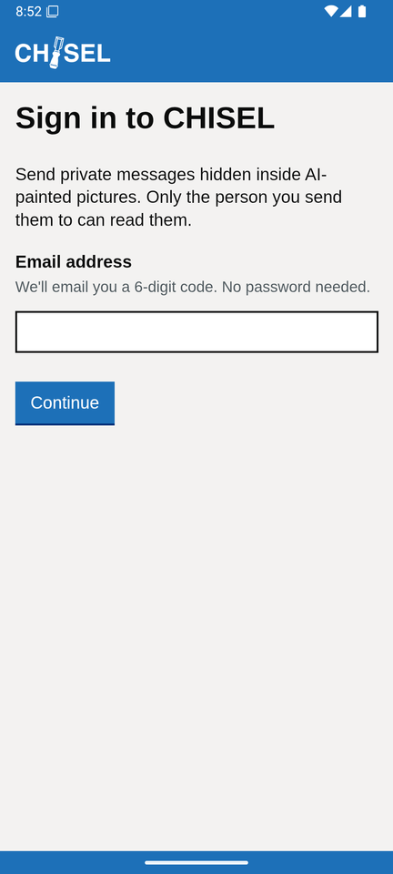

Enter your email address and tap **Continue**. There's no password: CHISEL emails you a 6-digit code.

 

## 3. Enter the code

Open the email from **CHISEL** (check *Spam* or *Promotions* if it isn't in your inbox), type the 6-digit code and tap **Continue**. Codes expire after 5 minutes; tap *Send a new code* if needed.

At this moment your phone creates your encryption keys. The private keys stay on the phone; only the public halves are sent to the server.

 

## 4. Choose your name

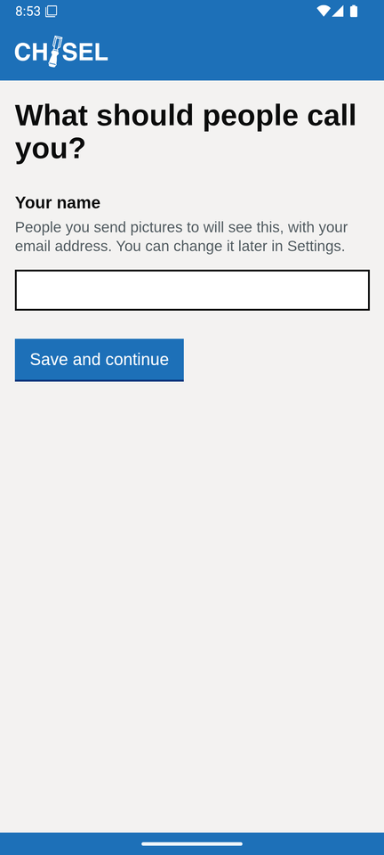

New accounts pick the name other people will see, next to your email. You can change it later in **Settings**.

 

## 5. Allow notifications

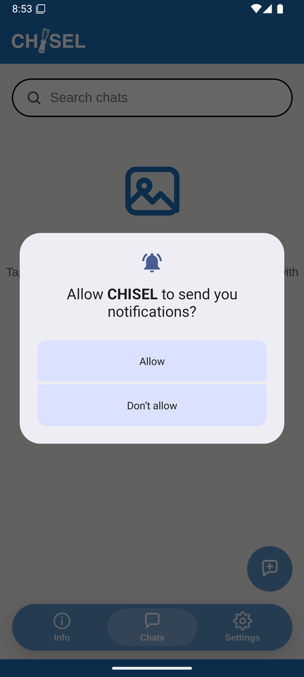

On Android 13 and newer, CHISEL asks once whether it may send notifications. Tap **Allow** to be told when a picture arrives. A notification only says who sent it, never what it says. You can turn them off later in **Settings**.

 

---

## 6. Your chats

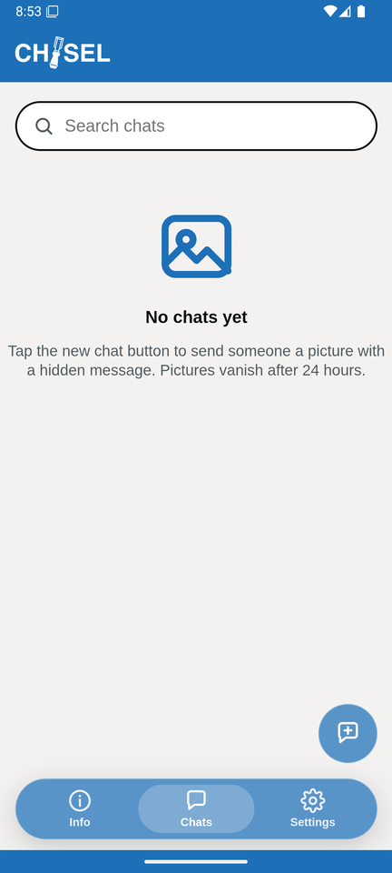

The **Chats** tab lists your conversations under the CHISEL title. The glass bar at the bottom switches between **Info**, **Chats** and **Settings**.

To start a conversation, tap the round **new chat** button at the bottom right.

 

## 7. Start a new chat

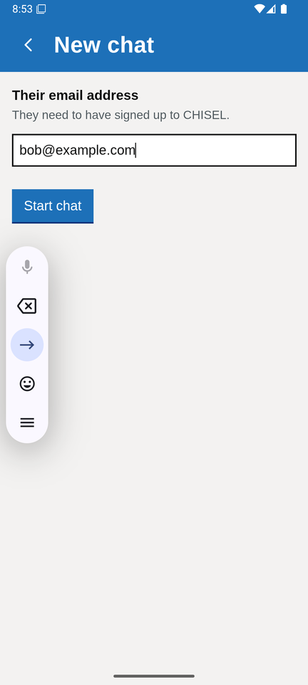

Type the email address of someone who has already signed up to CHISEL and tap **Start chat**. CHISEL fetches their public key and checks it's genuinely theirs.

 

## 8. Write a message

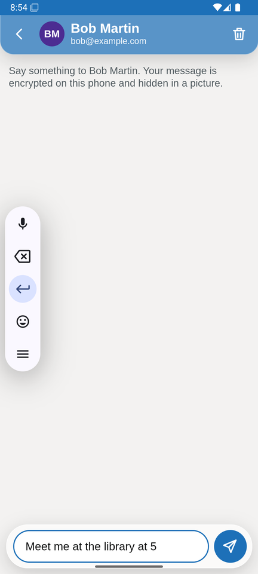

The chat shows their name and email at the top. Type your message (up to 2,000 characters) in the box at the bottom and tap the send button.

 

## 9. It's sent as a picture

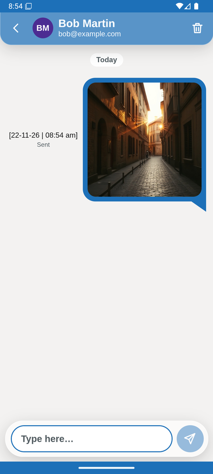

Your phone encrypts the message, signs it, gets a fresh AI-painted picture from the server and hides the message inside it. Only the picture is uploaded. Sent pictures appear on the right, in blue, with the bubble's tail at the bottom-right corner, and the date and time.

 

---

## 10. A reply arrives

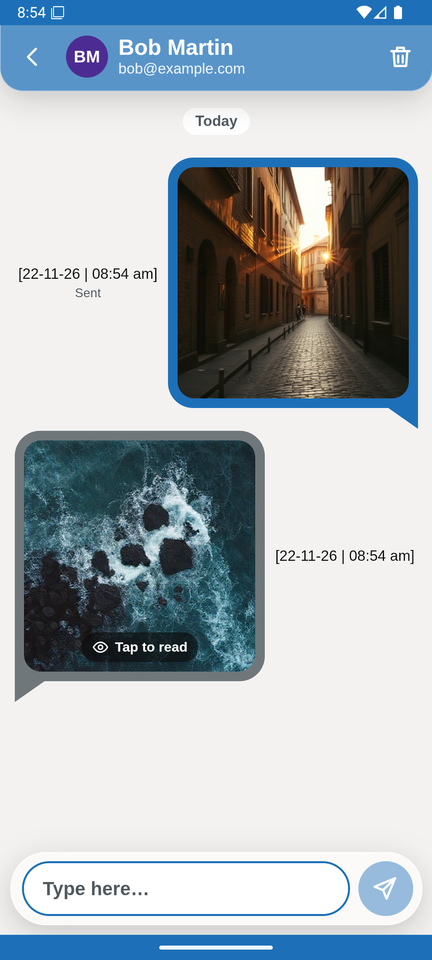

Pictures sent to you appear on the left, in grey, with the tail at the bottom-left corner, within about 15 seconds while the chat is open. New ones are marked **Tap to read**.

 

## 11. Tap to read

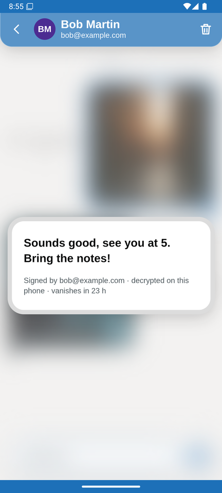

Tap the picture. Your phone finds the hidden bits with your private key, checks the sender's signature and decrypts the message. Everything except the sender's name is blurred while it's shown. Tap outside the card, or press back, to close it.

If anyone altered even one dot of the picture, CHISEL refuses to open it.

 

## 12. Check their safety number

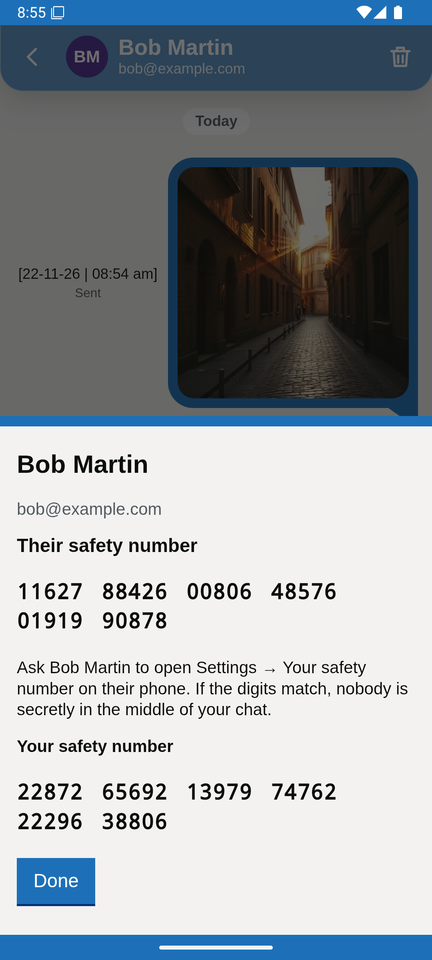

Tap the contact's name at the top of the chat to see **their safety number** next to **yours**. Ask them to open *Settings → Your safety number* on their phone: if the digits match on both phones, nobody is secretly in the middle.

 

---

## 13. Pull down to refresh

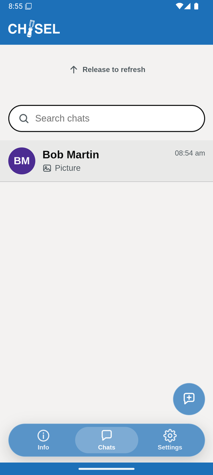

The chat list checks for new pictures by itself every 15 seconds while it's open. To check right away, pull the list down until it says **Release to refresh**, then let go.

 

## 14. Notifications

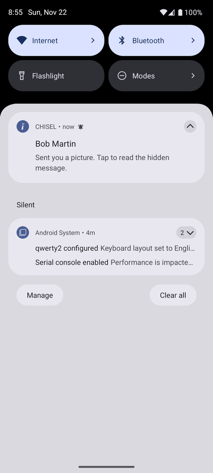

When a picture arrives and CHISEL isn't on screen, you get a notification with the sender's name and a white chisel icon. It never shows the message: that stays locked in the picture until you tap it in the app. Tap the notification to open CHISEL.

While CHISEL is closed, Android lets it check about every 15 minutes, so a notification can take that long to appear.

 

## 15. Back to your chats

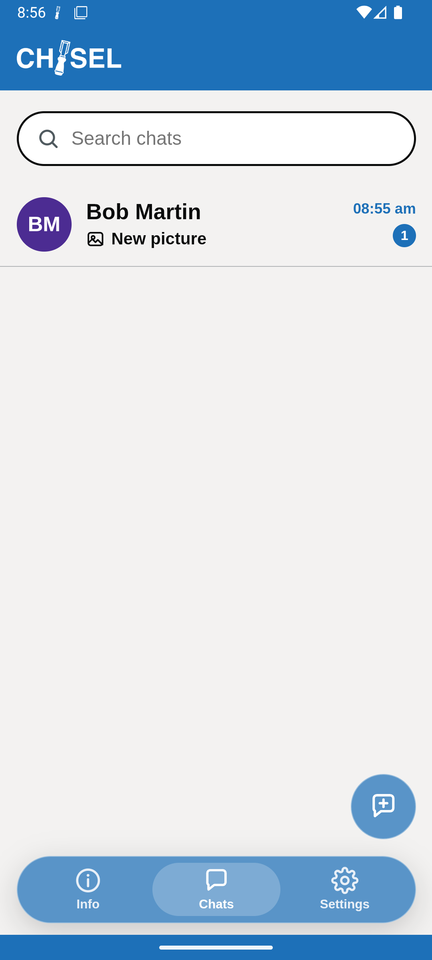

Conversations are listed newest first, with a badge for unread pictures. Everything vanishes **24 hours** after it was sent.

 

---

## 16. Settings: your account

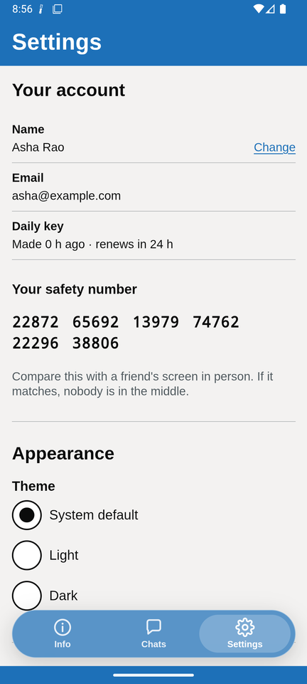

**Settings** shows your name (tap *Change* to edit it), email, how old your daily key is, and **your safety number**.

 

## 17. Settings: appearance and notifications

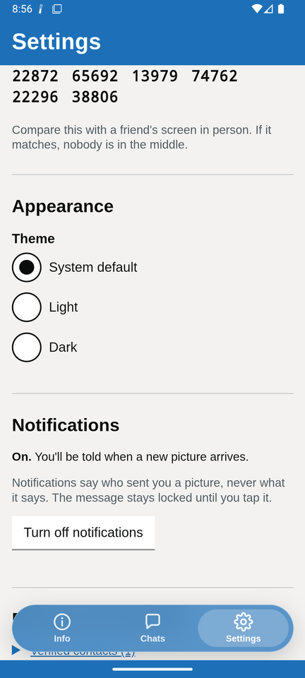

Choose **System default**, **Light** or **Dark** under *Appearance*, and turn notifications on or off under *Notifications*.

 

## 18. Settings: privacy and account

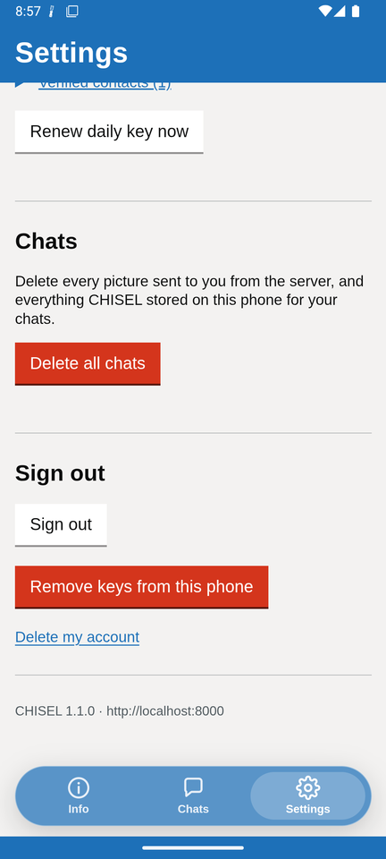

- **Verified contacts**: the safety numbers of people you've messaged.
- **Renew daily key now**: replaces your encryption key early. Unread pictures become unreadable.
- **Delete all chats**: removes pictures sent to you and everything stored for your chats on this phone.
- **Sign out**: your keys stay on the phone for next time.
- **Remove keys from this phone** and **Delete my account** (confirmed with an email code).

 

## 19. Dark mode

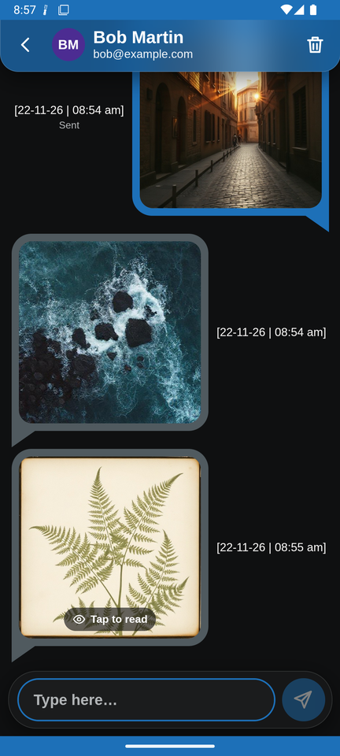

The same chat in dark mode.

 

---

## Good to know

- **One phone per account.** Your keys live on the phone that created them. Signing in on a new phone (or after clearing CHISEL's data) creates new keys; your contacts will see that your safety number changed.
- **Messages are temporary.** Pictures disappear after 24 hours, and your phone renews its key daily, so old messages can never be decrypted again.
- **"Safety number changed" warning.** If a contact's keys change, CHISEL stops and shows the old and new numbers. Check with them before tapping *trust*.
- **Notifications are private.** They name the sender, never the message.
