# Chisel walkthrough

A screen-by-screen tour of the Android app, from installing it to reading a hidden message. All screenshots come from Chisel 1.0.0 running on an Android 16 phone emulator.

> The "Demo server" box in step 3 only appears on a local test server. On the live server the code arrives **only by email**.

---

## 1. Open Chisel

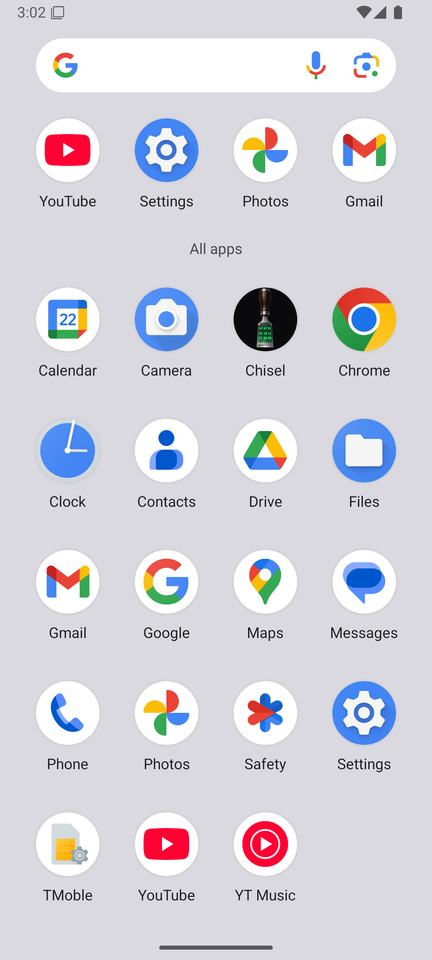

After installing the APK, Chisel appears in the app drawer with the chisel logo. Tap it to open.

The first launch can take up to a minute if the server has been idle (it sleeps on the free hosting plan). After that it's quick.

 

---

## 2. Sign in with your email

Enter your email address and tap **Continue**. There's no password: Chisel emails you a 6-digit code.

 

## 3. Enter the code

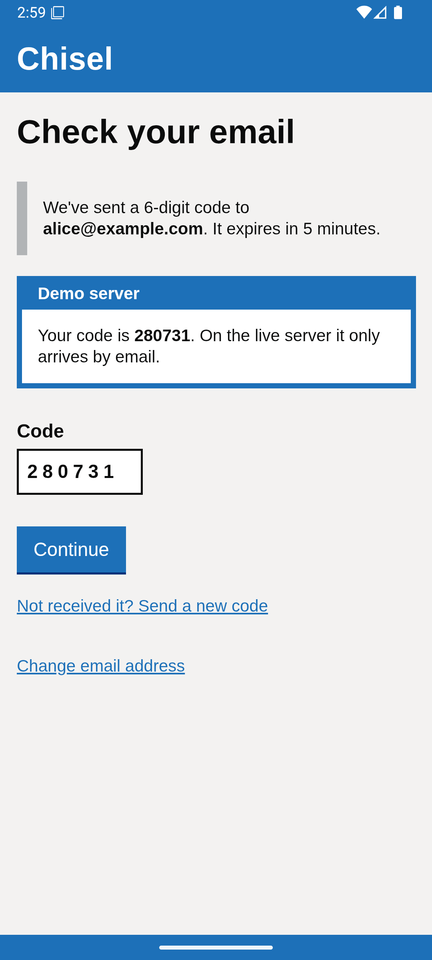

Open the email from **CHISEL** (check *Spam* or *Promotions* if it isn't in your inbox), type the 6-digit code and tap **Continue**. Codes expire after 5 minutes; tap *Send a new code* if needed.

At this moment your phone creates your encryption keys. The private keys stay on the phone; only the public halves are sent to the server.

 

## 4. Choose your name

New accounts pick the name other people will see, next to your email. You can change it later in **Settings**.

 

---

## 5. Your chats

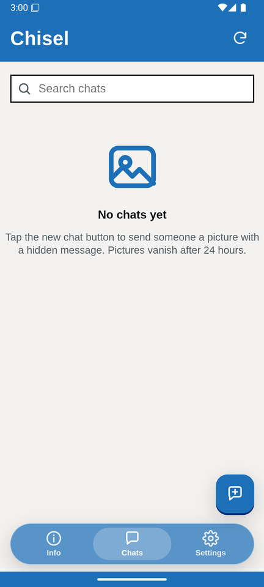

The **Chats** tab lists your conversations. The bar at the bottom switches between **Info**, **Chats** and **Settings**.

To start a conversation, tap the **new chat** button at the bottom right.

 

## 6. Start a new chat

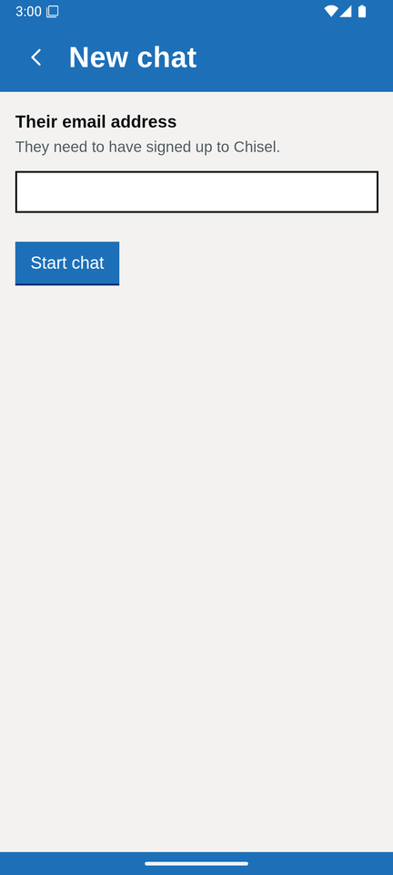

Type the email address of someone who has already signed up to Chisel and tap **Start chat**. Chisel fetches their public key and checks it's genuinely theirs.

 

## 7. Write a message

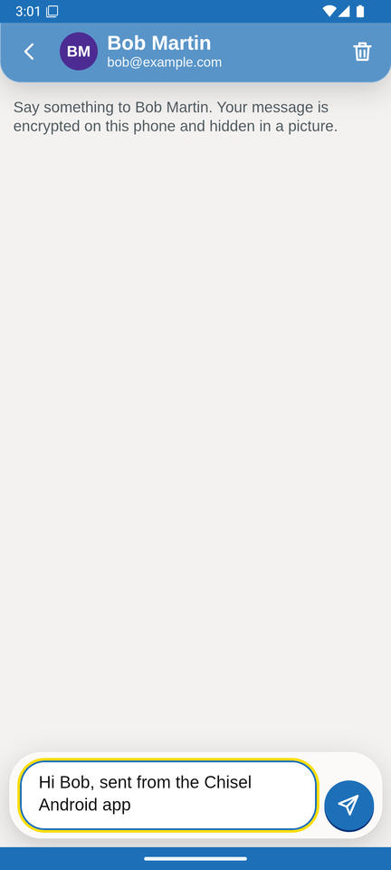

The chat shows their name and email at the top. Type your message (up to 2,000 characters) in the box at the bottom and tap the send button.

 

## 8. It's sent as a picture

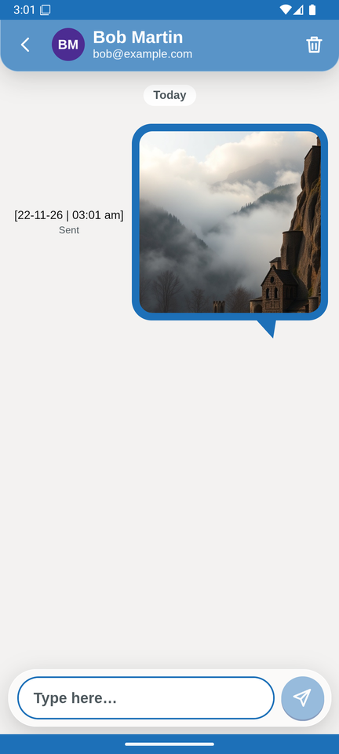

Your phone encrypts the message, signs it, gets a fresh AI-painted picture from the server and hides the message inside it. Only the picture is uploaded. Sent pictures appear on the right, in blue, with the date and time.

 

---

## 9. A reply arrives

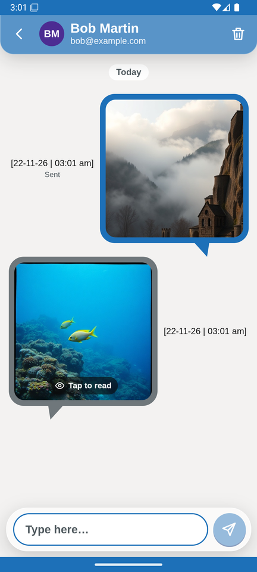

Pictures sent to you appear on the left, in grey, within about 15 seconds (or when you reopen the app). New ones are marked **Tap to read**.

 

## 10. Tap to read

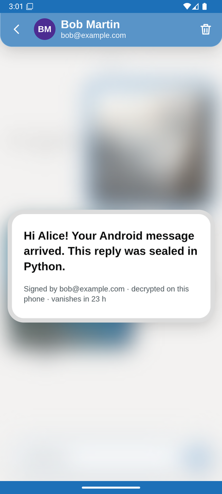

Tap the picture. Your phone finds the hidden bits with your private key, checks the sender's signature and decrypts the message. Everything except the sender's name is blurred while it's shown. Tap outside the card, or press back, to close it.

If anyone altered even one dot of the picture, Chisel refuses to open it.

 

## 11. Back to your chats

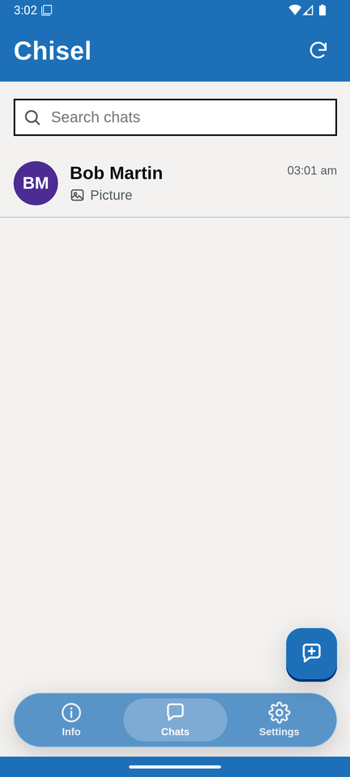

Conversations are listed newest first, with a badge for unread pictures. Everything vanishes **24 hours** after it was sent.

 

---

## 12. Settings: appearance

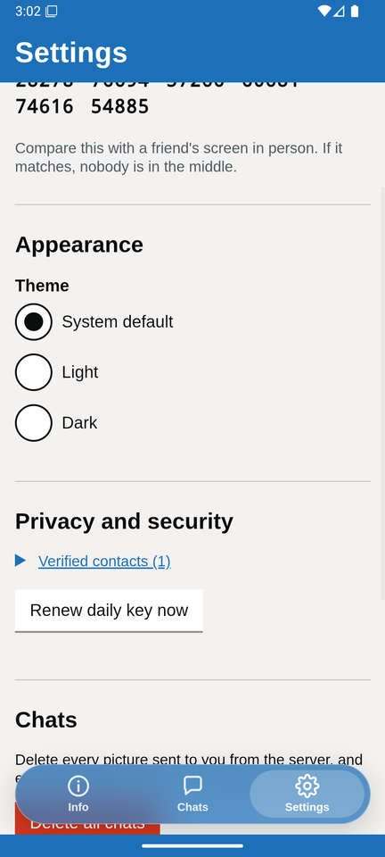

**Settings** shows your name, email and **safety number**. Compare safety numbers with a friend in person: if they match, nobody is secretly in the middle.

Choose **System default**, **Light** or **Dark** under *Appearance*.

 

## 13. Settings: privacy and account

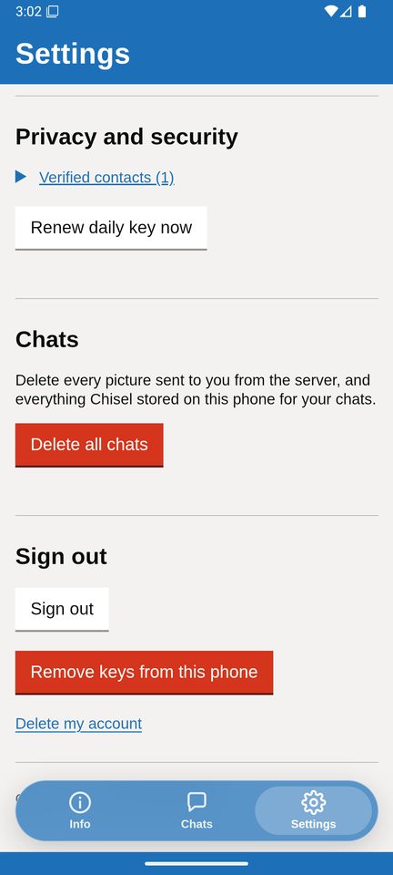

- **Verified contacts**: the safety numbers of people you've messaged.
- **Renew daily key now**: replaces your encryption key early. Unread pictures become unreadable.
- **Delete all chats**: removes pictures sent to you and everything stored for your chats on this phone.
- **Sign out**: your keys stay on the phone for next time.
- **Remove keys from this phone** and **Delete my account** (confirmed with an email code).

 

## 14. Dark mode

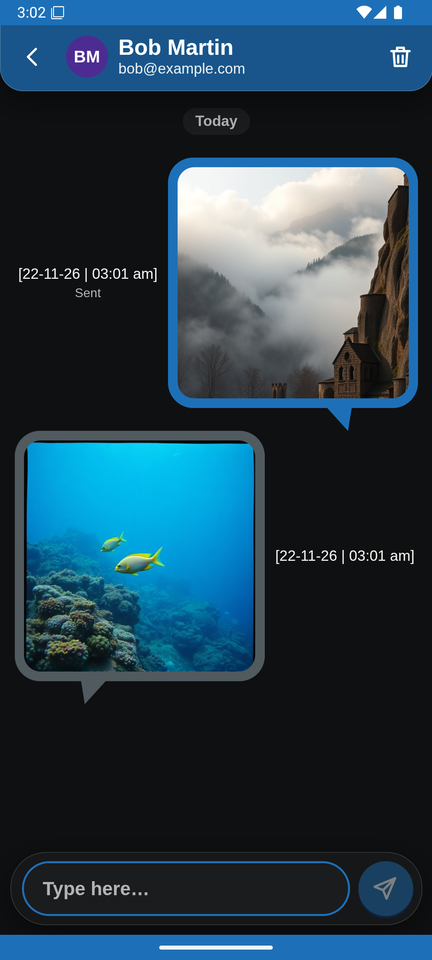

The same chat in dark mode.

 

---

## Good to know

- **One phone per account.** Your keys live on the phone that created them. Signing in on a new phone (or after clearing Chisel's data) creates new keys; your contacts will see that your safety number changed.
- **Messages are temporary.** Pictures disappear after 24 hours, and your phone renews its key daily, so old messages can never be decrypted again.
- **"Safety number changed" warning.** If a contact's keys change, Chisel stops and shows the old and new numbers. Check with them before tapping *trust*.
